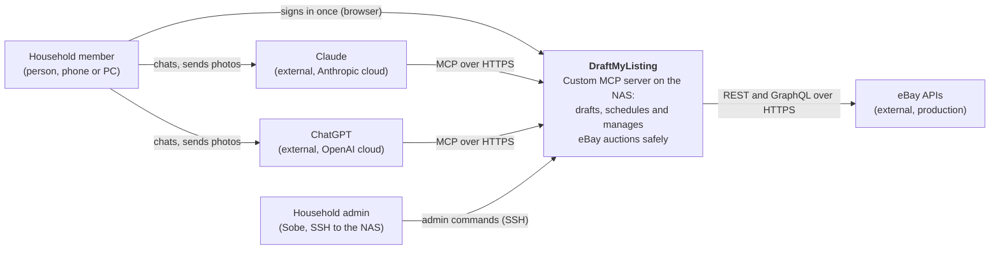
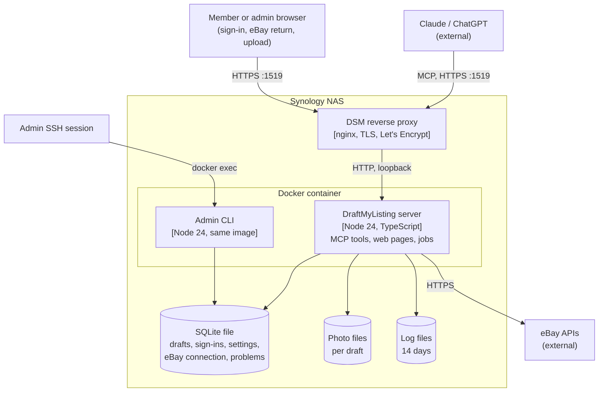
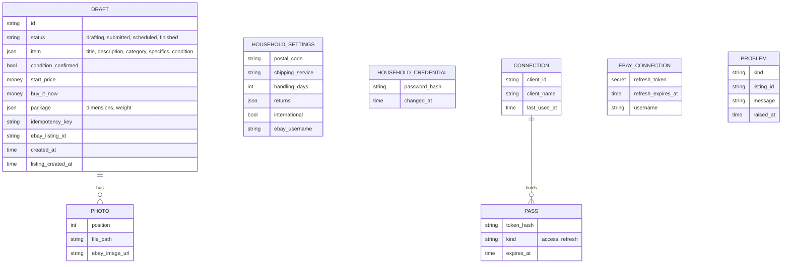
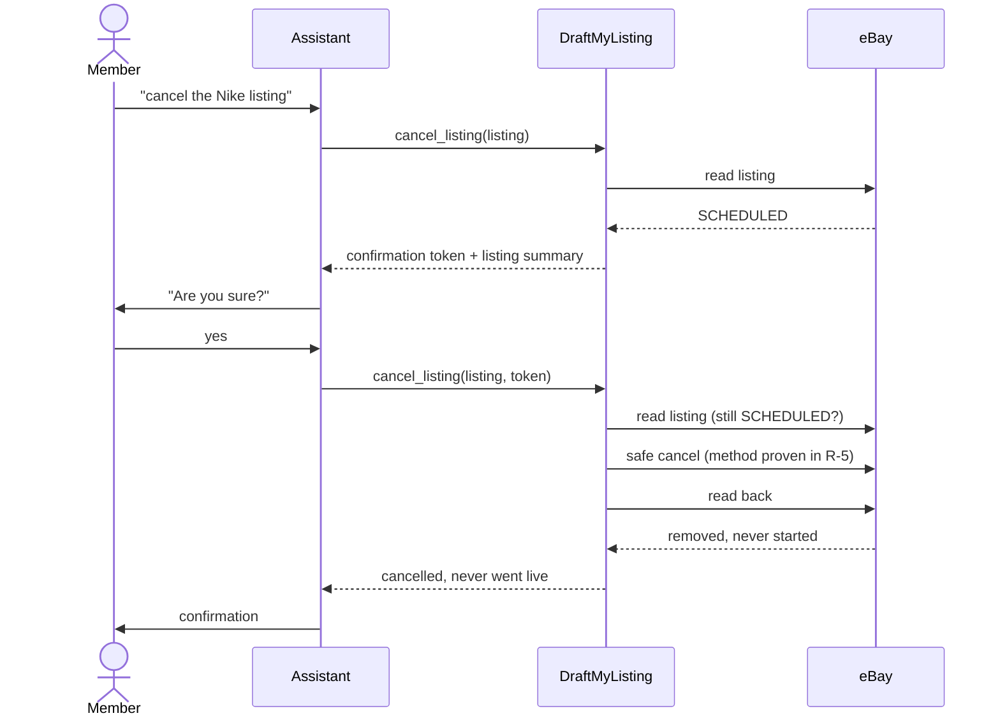
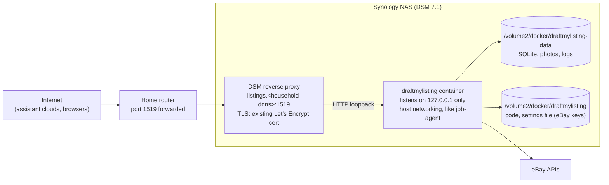

# Architecture: DraftMyListing

> Status: Approved by Sobe 2026-11-27 (ADR-008 stays Proposed until spike R-2) ·
> Last updated: 2026-11-27 · Author: Claude, with Sobe
>
> Requirements: [`docs/srs.md`](srs.md) v1.0 (source of truth) and
> [`docs/use-cases.md`](use-cases.md). Feasibility evidence:
> [`docs/poc/ebay-listing-feasibility.md`](poc/ebay-listing-feasibility.md).

## 1. Introduction and goals

DraftMyListing is a custom MCP server that sits between the household's AI
assistants (Claude and ChatGPT) and eBay's API. A member sends a few photos to
their assistant; the assistant identifies the item and researches it, and the
server turns that into a complete, scheduled 10-day eBay auction on the
household's one seller account, under fixed safety rules. Requirements are in
the SRS; this document says how they are met.

**Top quality goals (ranked):**

1. **Safety with eBay.** Nothing goes live by surprise and live listings are
   never touched (G-3, FR-SCHED-003, FR-LIST-007, FR-LIST-013). A mistake here
   costs real money or a real sale, so this outranks everything else.
2. **Least member effort.** Photos in, listing out; ask only what the photos
   can't show (G-1, FR-DRAFT-018).
3. **Low operations on a home NAS.** One thing to run, no paid services, no
   backups, restarts by itself (NFR-PORT-001, NFR-COMPL-002, NFR-REL-001..003).

**Stakeholders:** Sobe (builder, admin and seller); about two other household
members (sellers, no technical setup).

## 2. Constraints

| Constraint | Source | Effect on the design |
|---|---|---|
| Synology NAS, DSM 7.1, Docker 20.10, standalone `docker-compose` 1.28 | NFR-PORT-001; job-agent's NAS | One container, deployed like job-agent; no `docker compose` v2 features. |
| No paid services | NFR-COMPL-002 | No managed cloud, tunnel domain or paid data sources. |
| Assistants call from their own cloud | PoC question 8; EIR-COM-001 | Public HTTPS address; sign-in on every request. |
| eBay sandbox can't validate listings | PoC question 2 | Tests use recorded responses; live checks run in production under the safety rules. |
| eBay API terms; minimum scopes; no scraping | NFR-COMPL-001, FR-EBAY-003 | Only official APIs; the assistant's own web search for sold prices. |
| One shared household sign-in; no individual users | SRS 2.3, FR-AUTH-012 | Auth identifies connections, not people. |
| Chat only; no app of its own | SRS 1.2, FR-NOTIF-001 | Pages limited to sign-in, eBay return and an optional photo upload link. |
| Builder: Sobe with AI coding agents; the existing PoC code is TypeScript | Interview 2026-11-27 | TypeScript, reuse PoC modules (ADR-002). |

## 3. Context and scope

Inside the boundary: the DraftMyListing MCP server and its data on the NAS.
Outside: members and their assistants, the admin's SSH session, DSM's reverse
proxy, and eBay.



The assistants do the "thinking" (seeing the photos, identifying the item,
web research, writing text). DraftMyListing does the "doing" (eBay calls,
rules, state). eBay is the source of truth for every listing (SRS 2.1).

## 4. Solution strategy

- **One custom MCP server, one container** on the NAS, with internal modules
  (ADR-001).
- **TypeScript on Node 24**, reusing the PoC's tested modules, on the stable
  1.x MCP SDK (ADR-002).
- **The assistant thinks, the server enforces:** tools are coarse-grained, and
  every rule that protects money or the account is computed or checked by the
  server, never left to the assistant (ADR-003).
- **One eBay gateway** that every eBay call passes through, enforcing the
  safety rules in one place (ADR-004).
- **SQLite plus files on disk** under `/volume2` (ADR-005).
- **Own OAuth sign-in inside the server**, built on the PoC provider, with one
  hashed household password and persisted sign-ins (ADR-006).
- **Public access through DSM's reverse proxy** on the existing domain and
  certificate; the server listens only on the NAS itself (ADR-007).
- **Photos arrive through the chat if possible, a one-time upload link if
  not**; proven by a spike first (ADR-008).
- **Background jobs in-process**; **admin by a CLI in the container** over SSH
  (ADR-009, ADR-010).
- **`node:test` throughout**, official MCP client for end-to-end tests,
  recorded eBay responses, coverage report-only (ADR-011).
- **Environments: local and production only** (ADR-012).

## 5. Building block view

### 5.1 Containers



The server and the CLI are the same image and share the data directory. They
are one deployable unit: one container, one compose service.

### 5.2 Modules inside the server

| Module | Responsibility | Depends on | SRS areas |
|---|---|---|---|
| `mcp` | MCP endpoint, tool definitions and descriptions, per-connection rate limit | `auth`, `drafts`, `listings`, `research`, `settings`, `problems` | FR-ASST, FR-ERR-006 |
| `auth` | OAuth authorization server (registration, PKCE, codes, access and refresh passes), sign-in page, guessing limits | `store` | FR-AUTH |
| `drafts` | Draft lifecycle: save details, condition gate, photos, prices, start time, submit, finish, cleanup | `ebay`, `photos`, `pricing`, `schedule`, `store` | FR-DRAFT, FR-PHOTO, FR-SCHED |
| `pricing` | Buy It Now from starting price (+30%, rounded up), validation of member prices | — | FR-PRICE-014..017 |
| `schedule` | Start time: earliest at least 24 h away that ends a 10-day auction at 22:00 US Eastern | — | FR-SCHED-004, NFR-L10N-002 |
| `photos` | Receive, check size and format, convert HEIC, store, order, upload via the gateway, delete | `ebay`, `store` | FR-PHOTO |
| `listings` | List, read, change and cancel scheduled listings, always read fresh from eBay | `ebay`, `problems` | FR-LIST |
| `research` | Category suggestions, item aspects, for-sale search, sold data if granted | `ebay` | FR-DRAFT-009..011, FR-PRICE-004, 011 |
| `ebay` | The gateway: tokens, retries, idempotency, safety guards, daily cap; the only code that calls eBay | `store` | FR-EBAY, FR-SCHED-001/003/011, FR-LIST-013, FR-ERR-001..005, 007 |
| `settings` | Household shipping and return settings, with confirm-before-apply | `store` | FR-TERMS-001, FR-ADMIN-003..005 |
| `problems` | Unresolved problems (failed cancel or change, eBay connection state) attached to tool results | `store` | FR-NOTIF-002, FR-EBAY-006 |
| `jobs` | Timers: 30-day draft cleanup, log pruning | `drafts`, `store` | FR-PHOTO-014, NFR-OBS-001 |
| `pages` | Sign-in, eBay return and optional upload pages | `auth`, `ebay`, `photos` | EIR-UI-002..004 |
| `store` | SQLite access and migrations; data-directory layout | — | NFR-REL-002 |
| `cli` | Admin commands: password, sign everyone out, connect eBay, health | `auth`, `ebay`, `store` | FR-ADMIN-001/002, FR-EBAY-001, NFR-OBS-002 |

Reused from the PoC: `src/ebay/{config,env-file,auth,graphql,media,listing-safety}.ts`
and `src/mcp/household-auth.ts`, extended (persistence, hashed password, the
household-wide guessing limit) rather than rewritten.

### 5.3 Conceptual data model

Detailed design owns the physical schema; new entities need an amendment
here.



`HOUSEHOLD_SETTINGS`, `HOUSEHOLD_CREDENTIAL` and `EBAY_CONNECTION` are single
rows. Deleting a draft deletes its photos (rows and files) and every record
about it, and nothing else (FR-PHOTO-012, FR-AUDIT-002).

### 5.4 Tool set (candidate)

Coarse-grained tools, named for how members ask (FR-ASST-006). Detailed design
fixes the contracts.

| Tool | Does | Server-enforced rules |
|---|---|---|
| `suggest_category`, `get_item_specifics`, `search_items_for_sale` | Research reads with the application token | — |
| `save_draft` | Create or update a draft's details | Required specifics present; title ≤ 80 characters |
| `add_photos` / `get_photo_upload_link` | Attach photos | ≤ 12; size ≥ 500 px; formats converted |
| `confirm_condition` | Record the member's condition choice | Gate for submission (FR-DRAFT-008) |
| `set_prices` | Starting price; Buy It Now computed | +30% minimum; no reserve; no Best Offer |
| `submit_draft` | Validate, report fees, create scheduled | Start time rule; daily cap; idempotency; never live |
| `finish_draft` | Member is done; delete the draft | — |
| `list_scheduled`, `get_listing` | Read fresh from eBay | — |
| `change_listing` | Update a scheduled listing | Refused if live |
| `cancel_listing` | Two-step: returns a confirmation token, then cancels | Refused if live; verify never went live |
| `get_settings`, `change_setting`, `list_connections` | Household admin in chat | Confirm before apply; no password or sign-out |

## 6. Runtime view

### 6.1 Draft and schedule a listing from photos [UC-01]

```mermaid
sequenceDiagram
    actor M as Member
    participant A as Assistant
    participant S as DraftMyListing
    participant E as eBay
    M->>A: photos (and optional note)
    A->>A: identify item from photos
    A->>S: suggest_category / get_item_specifics
    S->>E: Taxonomy (app token)
    E-->>S: category, required specifics
    S-->>A: category, specifics
    A->>M: one message: missing details + proposed condition
    M->>A: answers, confirms condition
    A->>A: web search for sold prices
    A->>S: save_draft, confirm_condition, set_prices
    A->>S: add_photos
    S->>E: Media API upload (user token)
    A->>S: submit_draft
    S->>E: createListing VALIDATE
    E-->>S: success + fees
    S->>E: createListing EXECUTE, scheduledToStartAt (idempotency key)
    E-->>S: SCHEDULED, listing ID
    S-->>A: title, prices, start/end, fees, link
    A->>M: summary; "done with this draft?"
```

Resilience shows up in the alternate flows: a rejected validation returns
eBay's errors for the assistant to fix or ask about (FR-SCHED-007/008); a
temporary eBay error is retried by the gateway (FR-ERR-001); a failure after
the photo upload leaves the draft and photos in place so a retry resumes
(FR-ERR-003); the idempotency key makes a repeated create safe (FR-SCHED-011).

### 6.2 Cancel a scheduled listing [UC-03]



If the status is anything but scheduled, the gateway refuses before calling
eBay (FR-LIST-013). If the cancel or the read-back fails, the server records a
`PROBLEM` and returns the time left before start and the Seller Hub fallback
(FR-LIST-010, FR-NOTIF-002).

## 7. Deployment view

**Environments:** local (each developer PC) and production (the NAS). No
staging (ADR-012).



The hostname is a placeholder for a new subdomain on the household's existing
Synology DDNS domain; the admin picks it. The real address is kept out of
this repository. Deployment follows job-agent's
pattern (scripted from the workstation, never editing files on the NAS), with
`restart: unless-stopped` for NFR-REL-001. Anything that changes the NAS needs
Sobe's explicit go-ahead, as in job-agent.

## 8. Cross-cutting concepts

### 8.1 Security

- **Network:** only the reverse proxy is reachable; the container listens on
  loopback (NFR-SEC-002). The proxy exposes only the MCP path, the OAuth and
  sign-in paths, the eBay return path, and the upload path when used. HTTPS
  terminates at the proxy (NFR-SEC-001).
- **Members:** OAuth 2.1 with dynamic client registration and PKCE, as in the
  PoC (EIR-COM-002). One household password, hashed with scrypt from
  `node:crypto` (FR-AUTH-008). Access passes 1 hour, rotating refresh passes
  30 days, stored only as hashes and persisted so a restart doesn't sign
  everyone out (FR-AUTH-004/005). Guessing limits: 5 per page, 10 per 15
  minutes household-wide (FR-AUTH-009/010).
- **eBay secrets:** the app keys live in a settings file outside the repo
  (the PoC's `DRAFTMYLISTING_ENV_FILE` pattern); the eBay refresh token lives
  in the SQLite file. Both sit in directories readable only by the deploy user
  and are never logged or returned by a tool (FR-EBAY-008).
- **Admin boundary:** password changes and signing everyone out exist only in
  the CLI, never as tools (FR-ADMIN-006).
- **Prompt injection:** tool results that echo eBay or web data are data, not
  instructions; tool descriptions tell the assistant so. No tool can reach a
  live listing, whatever the assistant asks (FR-LIST-013).
- **Patching (NFR-SEC-003):** every release runs `npm audit` and a scan of the
  container image; high or critical findings with an available fix are fixed
  and redeployed within 30 days. Dependencies are pinned to exact versions,
  and the base image is a pinned Node 24 release, rebuilt at least monthly.
- **eBay terms (NFR-COMPL-001):** only eBay's official APIs, with minimum
  scopes (FR-EBAY-003); the server never scrapes eBay pages. Sold-price web
  research is the assistant's own web search (ADR-003).

### 8.2 Data

SQLite via Node 24's built-in `node:sqlite` (checked working on Node
24.22.3; no native add-on to build), one file, migrations run at start-up.
Photos are files under a per-draft folder. No backups (NFR-REL-003): drafts
are temporary, and settings and connections can be re-created. Retention is
enforced by deletion: the draft on "done", or after 30 days (FR-PHOTO-012/014);
logs after 14 days (NFR-OBS-001). No activity history (FR-AUDIT-001).

### 8.3 Resilience and error handling

- **eBay gateway:** timeouts on every call; up to 3 retries with growing waits
  for temporary errors (FR-ERR-001); plain-language errors with no secrets
  (FR-ERR-002); call-limit responses passed back with the reset time
  (FR-ERR-005).
- **Idempotency:** each draft gets a 32-hex-character key at creation, reused
  on every create attempt (FR-SCHED-011; format from PoC question 2).
- **Resumable submit:** the draft records which steps finished (photos
  uploaded, validated, created), so a retry continues (FR-ERR-003).
- **Safety guards in the gateway, not the tools:** every create carries a
  future start and an explicit operation mode; change and cancel re-read the
  listing and refuse unless it is scheduled; the daily cap counts creates per
  US Eastern day (FR-SCHED-001/003, FR-LIST-013, FR-ERR-007).
- **Dependency down:** eBay unavailable keeps the draft (FR-SCHED-010); the
  eBay connection expired or revoked stops listing actions and raises a
  problem (FR-EBAY-009).
- **Problems:** the server can't see where a conversation starts, so
  unresolved problems ride along on every tool result, and the tool
  descriptions tell the assistant to mention them once per conversation. This
  is how FR-NOTIF-002 and FR-EBAY-006 are met.

### 8.4 Observability

Structured log lines (JSON) to files in the data directory: request outcome,
tool name, duration, eBay call outcome and error codes; never passwords,
tokens, photos or conversation text; pruned after 14 days (NFR-OBS-001).
Tool timings give NFR-PERF-001/003. `dml health` in the CLI reports whether
the server answers and whether the eBay connection is valid, with its expiry
date (NFR-OBS-002). No metrics stack or alerting (FR-NOTIF-001).

### 8.5 Performance and scaling

One process, 3 people, 3 chats at once (NFR-CAP-001): no caching layer, no
queue, no horizontal scaling. The eBay application token is cached for its
2-hour life and the user access token is renewed on demand (FR-EBAY-005).
Photos are resized only when needed for conversion, to keep uploads under 15
seconds (NFR-PERF-002).

### 8.6 Localization

English, US dollars and the eBay US marketplace (`EBAY_US`) only
(NFR-L10N-001). All times are stored in UTC. The `schedule` module computes
the 22:00 US Eastern end in the `America/New_York` zone, so daylight saving is
handled, and tool results give start and end times both in UTC and as
Eastern time, which the assistant restates in the member's own time zone
(NFR-L10N-002).

### 8.7 Testing

- **Shape:** mostly unit tests of the rule modules (`pricing`, `schedule`,
  `ebay` guards, `auth`), integration tests of modules against SQLite and
  recorded eBay responses, and a thin layer of end-to-end tests
  (NFR-MAINT-001/002).
- **Frameworks:** Node's built-in runner, `node:test`, for unit, integration
  and end-to-end tests. End-to-end tests drive the running server with the
  official MCP SDK client, exactly as an assistant would, with eBay replaced
  by recorded responses (ADR-011).
- **End-to-end flows:** draft and schedule from photos [UC-01], change a
  scheduled listing [UC-02], cancel [UC-03], finish and cleanup [UC-04],
  sign-in [UC-05], problems surfaced [UC-09].
- **Live checks:** a short, manual checklist against production eBay under the
  PoC safety rules, for what recordings can't prove (scheduled auction, safe
  cancel, photo path). Each live listing is cancelled before its start.
- **By hand:** MCP Inspector while building.
- **Coverage:** report-only, using `node:test`'s built-in coverage; no
  threshold (Sobe, 2026-11-27). Acceptance tests per requirement are the
  binding check.

## 9. Architecture decisions

### ADR-001: One MCP server in one container

**Status:** Accepted
**Date:** 2026-11-27
**Requirements addressed:** NFR-CAP-001, NFR-PORT-001, NFR-COMPL-002,
NFR-REL-001, EIR-COM-001

**Context**
The system has around a dozen capability areas but tiny load: 3 people and 20
listings a day. It runs on a home NAS, operated by one person, with no paid
services. The assistants need one connector address.

**Decision**
We will build one server process with internal modules (section 5.2) and ship
it as one container.

**Options considered**
- **One server, one container (chosen):** one thing to deploy, monitor and
  restart; modules share the eBay connection, drafts and sign-in without a
  network hop. Con: everything restarts together.
- **Separate services (for example sign-in, MCP and eBay worker):** independent
  deployment we don't need, plus internal networking and more to operate on a
  NAS. Lost on operations burden.
- **Serverless or cloud hosting:** costs money and moves the household's data
  off the NAS. Lost on NFR-COMPL-002.

**Consequences**
Simple to run and reason about. Module boundaries must be kept by discipline
(the eBay gateway rule in ADR-004 is the important one). Revisit only if a
second household or a much bigger load ever appears, which the SRS rules out.

### ADR-002: TypeScript on Node 24, reusing the PoC, on MCP SDK 1.x

**Status:** Accepted
**Date:** 2026-11-27
**Requirements addressed:** NFR-MAINT-001, NFR-COMP-001, FR-AUTH-001..003,
EIR-COM-002

**Context**
The PoC left about 2,000 lines of tested TypeScript: eBay config and tokens,
GraphQL and Media clients, listing safety checks, and an OAuth provider that
worked from Claude on PC and phone (40 tests). The official TypeScript MCP SDK
has full remote-server and sign-in support. A version 2 of the SDK is in beta
(its docs track a newer spec revision); the PoC uses 1.32.2.

**Decision**
We will build in TypeScript on Node 24, reuse and extend the PoC modules, and
stay on the stable 1.x MCP SDK, pinned to an exact version.

**Options considered**
- **TypeScript (chosen):** keeps the proven code and the most complete MCP SDK
  for remote sign-in. Con: HEIC conversion likely needs an add-on (R-7).
- **Python:** a good official MCP SDK and easier HEIC handling, and Sobe uses it
  for job-agent. Lost because it means rewriting and re-proving the PoC code.
- **Go or C#:** less mature MCP sign-in support, no existing code.
- **MCP SDK 2.x beta:** newer, but beta on an internet-facing server with
  sign-in. Deferred until it is stable.

**Consequences**
Fast start on proven code. A later move to SDK 2.x is a planned upgrade, not
part of the first version; revisit when 2.x is released as stable.

### ADR-003: The assistant thinks, the server enforces

**Status:** Accepted
**Date:** 2026-11-27
**Requirements addressed:** G-1, G-3, FR-DRAFT-003, FR-DRAFT-007, FR-DRAFT-008,
FR-DRAFT-018, FR-PRICE-005, FR-PRICE-014..018, FR-SCHED-004, FR-ASST-005,
FR-ASST-006, FR-ERR-007, NFR-USE-001, NFR-L10N-002, NFR-COMPL-001

**Context**
Seeing photos, identifying items, web research and writing listing text need a
multimodal model; the assistants already are one, and the server has no model
of its own (no paid services). But the SRS also has hard rules where an
assistant's slip would cost money: Buy It Now at least 30% above the start,
10-day auctions ending 22:00 Eastern, the condition gate, 12 photos, 20 a day.
The PoC showed assistants follow tool descriptions, but not perfectly
(question 8: Claude declined over a missing price).

**Decision**
We will leave perception, research and writing to the assistant, steered by
tool descriptions, and compute or check every money- or account-affecting rule
in the server. The server never trusts the assistant for a rule it can check.

**Options considered**
- **Split by kind of work (chosen):** uses each side for what it's good at;
  rules hold even if the assistant errs. Con: the quality of identification and
  wording depends on tool descriptions, which need testing with real requests.
- **Server-side model calls** (send photos to an AI API from the server):
  consistent results, but a paid API. Lost on NFR-COMPL-002.
- **Leave everything to the assistant:** fewest tools, but rules like the 30%
  gap and the start time would depend on model behavior. Lost on G-3.

**Consequences**
Rules are unit-testable in plain code. Tool descriptions become a first-class,
tested artifact (FR-ASST-006). Requirements written as "the system shall ask"
are met by descriptions plus server responses that say what's missing.

### ADR-004: A single eBay gateway with built-in safety guards

**Status:** Accepted
**Date:** 2026-11-27
**Requirements addressed:** G-3, FR-SCHED-001, FR-SCHED-003, FR-SCHED-011,
FR-LIST-007, FR-LIST-013, FR-ERR-001..005, FR-ERR-007, FR-EBAY-005,
FR-EBAY-009, UC-01, UC-03

**Context**
eBay's `createListing` defaults to `EXECUTE`, which makes a listing live at
once; removing a schedule in Seller Hub started a listing (PoC questions 2 and
4). Live listings must never be changed. Several modules need eBay.

**Decision**
All eBay calls go through one `ebay` module. It sets the operation mode
explicitly, refuses any create without a start at least 24 hours out, re-reads
status before every change or cancel and refuses unless it is scheduled,
applies the idempotency key, the daily cap, retries and token renewal. No
other module imports an eBay client. A lint rule enforces this.

**Options considered**
- **One gateway (chosen):** the safety rules live and are tested in one place.
  Con: one more layer.
- **Each module calls eBay directly:** less code, but the rules would be
  repeated and one forgotten guard could start a listing early. Lost on G-3.

**Consequences**
Safety is reviewable in one file set and covered by focused tests. There is a
small race: a listing can start between the status re-read and the change;
the gateway re-reads after any change and raises a problem if the listing is
live (R-5 covers the cancel path specifically).

### ADR-005: SQLite and files on disk

**Status:** Accepted
**Date:** 2026-11-27
**Requirements addressed:** NFR-REL-002, NFR-REL-003, NFR-CAP-001,
FR-PHOTO-012, FR-PHOTO-014, FR-AUDIT-002, FR-AUTH-004

**Context**
State is small: a few drafts at a time, settings, sign-ins, one eBay
connection. Drafts and sign-ins must survive a restart. No backups. Deleting a
draft must delete everything about it.

**Decision**
We will use one SQLite file through Node 24's built-in `node:sqlite`, and keep
photos as files in a per-draft folder, all under the data directory on
`/volume2`.

**Options considered**
- **SQLite + files (chosen):** no server to run, transactional, easy to delete
  per draft, survives restarts. Con: one writer, which this load never strains.
- **JSON files only:** simplest, but no transactions; partial writes on a crash
  could corrupt drafts or sign-ins.
- **Postgres or another database server:** a second container to run for no
  benefit at this scale.

**Consequences**
Nothing extra to operate. `node:sqlite` worked on Node 24.22.3 in a check on
2026-11-27; if it proves unstable, `better-sqlite3` is a drop-in fallback at
the cost of a native add-on (R-6).

### ADR-006: Own OAuth sign-in with one hashed household password

**Status:** Accepted
**Date:** 2026-11-27
**Requirements addressed:** FR-AUTH-001..010, FR-AUTH-012, FR-ADMIN-001,
FR-ADMIN-002, NFR-SEC-001, EIR-COM-002, UC-05, UC-08

**Context**
Both assistants connect to remote MCP servers through OAuth. The PoC built a
working provider with the MCP SDK's auth router and our own sign-in page.
There are no individual users: one shared password. The PoC kept passwords in
plain text and passes in memory, so a restart signed everyone out.

**Decision**
We will run our own OAuth authorization server inside the server, extending
the PoC provider: one scrypt-hashed household password, passes and client
registrations stored as hashes in SQLite, the household-wide guessing limit,
and CLI commands to change the password or end all sign-ins.

**Options considered**
- **Own provider (chosen):** already proven with Claude; no third party; fits
  the shared-password model. Con: we own the security of the code.
- **An external identity provider** (for example Auth0 or Google sign-in):
  strong, but built for individual accounts, adds an outside dependency and
  can cost money. Lost on SRS 2.3 and NFR-COMPL-002.
- **A static bearer token pasted into each assistant:** simplest, but neither
  assistant's phone app is set up for that, and it can't be revoked per
  device. Lost on G-5.

**Consequences**
Sign-ins survive restarts, and a password change ends them all. The auth code
is security-critical and needs strong tests, which the PoC started (FR-AUTH
tests).

### ADR-007: Public access through DSM's reverse proxy

**Status:** Accepted
**Date:** 2026-11-27
**Requirements addressed:** NFR-SEC-001, NFR-SEC-002, NFR-COMPL-002,
EIR-COM-001

**Context**
The assistants call from their own cloud, so the server needs a public HTTPS
address. The NAS already exposes job-agent's tailor through DSM's reverse
proxy on the household's DDNS domain, port 1519, with a Let's Encrypt certificate. The PoC
used a temporary tunnel on the standard port 443.

**Decision**
We will publish the server as a new subdomain on DSM's reverse proxy, port
1519, with TLS from the existing certificate; the container listens only on
loopback.

**Options considered**
- **DSM reverse proxy (chosen):** nothing new to run or pay for; matches
  job-agent. Con: a non-standard port in the connector address, unproven with
  both assistants (R-1).
- **Cloudflare Tunnel:** standard port, no open router port, but needs a
  Cloudflare-managed domain. Lost on cost.
- **Tailscale Funnel:** free and standard port, but one more agent on the NAS.
  Kept as the fallback if R-1 fails.

**Consequences**
No new infrastructure. The port check (R-1) runs first in construction; if
either assistant refuses `:1519`, switch to the Tailscale Funnel fallback
before building further.

### ADR-008: Photos through the chat, with an upload-link fallback

**Status:** Proposed (pending spike R-2)
**Date:** 2026-11-27
**Requirements addressed:** FR-ASST-004, FR-PHOTO-001..008, EIR-UI-004,
TBD-006

**Context**
The assistant sees the member's photos, but it is unproven that it can pass
the image files, at full quality, to a tool on our server (TBD-006). Sobe
accepted two fallbacks: a one-time upload link, or adding photos on eBay
directly. eBay rejected a listing with too few images (PoC question 2).

**Decision**
We will spike the chat path first, in both assistants. If it delivers full
quality images, photos arrive as tool input. If not, the server issues a
one-time upload link (single use, short expiry, tied to the draft) served by
the `pages` module.

**Options considered**
- **Tool input (preferred if proven):** no extra step for the member (G-1).
- **One-time upload link:** works on any device, but one extra tap and a small
  page to secure.
- **Photos only on eBay:** no page at all, but eBay may refuse the listing with
  no photo, and the assistant could not use the photos for anything after
  identification. Kept as a last resort.

**Consequences**
Photo handling (checks, HEIC conversion, ordering) is the same for either
path once the files arrive. The choice and any HEIC library are settled by the
spike and recorded by updating this ADR.

### ADR-009: Background jobs inside the server

**Status:** Accepted
**Date:** 2026-11-27
**Requirements addressed:** FR-PHOTO-014, NFR-OBS-001, FR-EBAY-006

**Context**
Two time-driven tasks: delete drafts 30 days after their listing was created,
and prune logs after 14 days. The eBay expiry warning is computed on demand.

**Decision**
We will run these as timers inside the server process, checked at start-up and
then hourly. The jobs are idempotent, so a missed run is caught by the next.

**Options considered**
- **In-process timers (chosen):** nothing extra to configure.
- **DSM Task Scheduler or cron in the container:** another moving part, and
  job-agent's notes show it needs care on this NAS.

**Consequences**
If the server is down for a while, cleanup catches up when it restarts, which
is acceptable for 30-day and 14-day windows.

### ADR-010: Admin commands as a CLI in the container

**Status:** Accepted
**Date:** 2026-11-27
**Requirements addressed:** FR-ADMIN-001, FR-ADMIN-002, FR-ADMIN-006,
FR-EBAY-001, FR-EBAY-007, NFR-OBS-002, UC-06, UC-08, UC-10

**Context**
Sobe chose a mixed admin approach: password and sign-out on the NAS only, so
the password never passes through an assistant provider (SRS 3.9).

**Decision**
The image ships a `dml` command (`dml password`, `dml signout-all`,
`dml connect-ebay`, `dml health`), run with `docker exec` over SSH. Passwords
are read from the terminal, never from arguments, so they don't land in shell
history.

**Options considered**
- **CLI in the container (chosen):** same code and data as the server, nothing
  exposed to the internet.
- **An admin web page:** convenient, but a new internet-facing surface guarded
  by the same shared password. Lost on NFR-SEC-002.

**Consequences**
Admin needs SSH to the NAS, which Sobe already uses for job-agent.
`dml connect-ebay` prints the eBay sign-in link; the return lands on the
`pages` module, which completes the connection (FR-EBAY-002).

### ADR-011: `node:test` with the official MCP client, coverage report-only

**Status:** Accepted
**Date:** 2026-11-27
**Requirements addressed:** NFR-MAINT-001, NFR-MAINT-002, NFR-COMP-001

**Context**
The PoC's 40 tests use `node:test`. Current practice for MCP servers (searched
2026-11-27) is to drive the server with the official MCP client in tests, and
use the MCP Inspector by hand. eBay's sandbox can't validate listings.

**Decision**
We will use `node:test` for unit, integration and end-to-end tests. End-to-end
tests start the server and call it with the official MCP SDK client, with eBay
replaced by recorded responses; a manual live checklist covers the rest.
Coverage is reported with `node:test`'s built-in coverage, with no threshold.

**Options considered**
- **`node:test` + MCP client (chosen):** no new test dependency; tests exercise
  the real protocol.
- **Vitest:** popular in MCP examples with nicer output, but a new dependency
  and a migration of the existing tests.
- **A community MCP test kit:** a thin wrapper around the same client from a
  single maintainer.
- **Enforced coverage threshold:** declined by Sobe in favor of
  per-requirement acceptance tests.

**Consequences**
One runner and one command (`npm run check`). Recorded eBay responses must be
refreshed when eBay changes; live checks stay small and follow the safety
rules.

### ADR-012: Local and production only

**Status:** Accepted
**Date:** 2026-11-27
**Requirements addressed:** NFR-PORT-001, NFR-COMPL-002, NFR-MAINT-002

**Context**
eBay's sandbox can't validate listings (PoC question 2), so a staging
environment couldn't exercise the core flow. There is one NAS and three users.

**Decision**
Two environments: local on a developer PC (eBay recorded responses by
default, or production eBay under the safety rules) and production on the NAS.

**Options considered**
- **Local + production (chosen):** matches what eBay allows and the household's
  scale.
- **Staging on the NAS:** a second copy that would still have to hit
  production eBay, adding risk without adding proof.

**Consequences**
Production is where the live checks run, carefully. Release safety comes from
tests, the gateway guards and the live checklist rather than a staging copy.

## 10. Quality scenarios

| NFR | Scenario |
|---|---|
| NFR-PERF-001 | With 3 conversations active, 95% of tool calls finish within 5 s, excluding eBay time, measured from the server's own timings over a week. |
| NFR-PERF-002 | A 12-megapixel phone photo uploads to eBay within 15 s from the NAS. |
| NFR-PERF-003 | 95% of `submit_draft` calls schedule the listing within 2 min. |
| NFR-REL-001 | After `sudo reboot` of the NAS, the MCP endpoint answers within 5 min with no manual step. |
| NFR-REL-002 | Kill the container mid-draft; after restart the assistant continues the same draft. |
| NFR-SEC-002 | An external scan finds only port 1519, and only the listed paths answer. |
| NFR-OBS-002 | `dml health` reports "eBay connection valid until <date>", or "expired" after the refresh token is revoked. |
| G-3 | With the gateway's guards, no test or live check produces a listing that starts within 24 h of creation, or a change to a live listing. |

## 11. Risks and technical debt

| ID | Risk or debt | Plan |
|---|---|---|
| R-1 | Claude and ChatGPT may not accept a connector address with port `:1519`. | First construction task: throwaway server behind the proxy, connect from both. Fallback: Tailscale Funnel (ADR-007). |
| R-2 | Chat photos may not reach a tool at full quality (TBD-006). | Spike in both assistants before building `photos`; fallback upload link (ADR-008). |
| R-3 | ChatGPT connector support, especially on phones, is untested (TBD-001). | Test during the first slice; members may use Claude where ChatGPT fails. |
| R-4 | Scheduled auctions through the GraphQL API, and the cost of 10-day auctions, are unproven (TBD-004). | Live check early: validate, create scheduled, read back fees, cancel before start. |
| R-5 | No safe cancel of a scheduled listing is proven; removing the schedule starts the listing (PoC question 4). | Prove a method (API end or delete of a scheduled listing) in a live check before `cancel_listing` ships; until then, the tool points to Seller Hub Delete. |
| R-6 | `node:sqlite` stability on Node 24. | Worked in a 2026-11-27 check; `better-sqlite3` fallback. |
| R-7 | HEIC conversion may need an image add-on in Node. | Decide after R-2 shows which formats actually arrive. |
| R-8 | The `/mcp` endpoint answered some HTTP 400s on connect in the PoC, cause unlogged. | Log the method on every 400 from the first build. |
| R-9 | Tool descriptions steer behavior; Claude once declined instead of asking (PoC question 8). | Test descriptions with real member phrasing in both assistants (FR-ASST-005/006). |
| D-1 | MCP SDK stays on 1.x while 2.x is in beta. | Planned upgrade when 2.x is stable (ADR-002). |
| D-2 | Dev-only `minimatch` advisory accepted in the PoC. | Update when ESLint and typescript-eslint ship on a fixed version. |
| D-3 | No backups. | Accepted (NFR-REL-003); re-create settings and connections if the data is lost. |

## 12. Glossary

See SRS section 1.3. Additional terms: **gateway** (the `ebay` module, the only
code that calls eBay), **pass** (an OAuth access or refresh token issued to an
assistant), **problem** (an unresolved failure the server reports on every tool
result until it clears).
