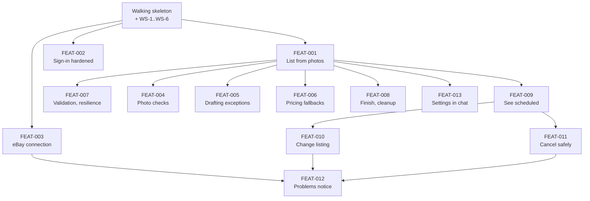

# Implementation Plan: DraftMyListing

> Status: Draft · Last updated: 2026-11-27
> Inputs (all found): [`docs/srs.md`](srs.md) v1.0 ·
> [`docs/use-cases.md`](use-cases.md) · [`docs/architecture.md`](architecture.md) ·
> [`docs/ux-foundations.md`](ux-foundations.md)

## 1. Overview

One custom MCP server on the NAS, built by Sobe with AI coding agents, no
deadline. The order is set by **risk first**: the architecture's open risks
(R-1 to R-5) could each force a design change, so they are retired inside the
walking skeleton phase, before feature work. After that, the first slice
delivers the core value (photos in, scheduled auction out), then the household
gets the ability to see and safely cancel what it created, and the rest fills
in. MVP cut line: every Must requirement (SRS v1.0 is an MVP; Sobe,
2026-11-27). The one Could (FR-PRICE-004) waits for eBay to grant access.

## 2. Walking skeleton

The thinnest end-to-end path through every container: assistant → DSM reverse
proxy → server → SQLite and eBay, deployed to the NAS. Because the server is on
the internet from day one, sign-in is real, not stubbed.

**Real:**
- Repo layout per architecture §5.2 (modules as folders), Dockerfile and
  compose file, deployed to the NAS by script like job-agent, behind DSM's
  reverse proxy on a new subdomain at port 1519 with the existing certificate.
- MCP endpoint (SDK 1.x, pinned) with the PoC sign-in moved into `auth`, using
  a household password from the settings file (hashing and persistence come in
  FEAT-002).
- `store` with `node:sqlite`, a first migration and a data directory on
  `/volume2`.
- `ebay` gateway skeleton holding the PoC's config, token and safety-check
  modules; `dml connect-ebay` working as in the PoC (hardened in FEAT-003).
- One trivial tool, `check_photo`, that accepts a photo and returns what
  arrived (byte size, pixel size, format). It is the R-2 probe.
- Structured JSON logs (method logged on every HTTP 400: R-8); `dml health`
  minimal ("server up").
- SCR-WEB-001 sign-in page styled from `design.md` / `tokens.json`: the UI
  shell for the web surface.

**Stubbed:** drafting, pricing, listing tools, settings, problems, jobs.

**Risk checks run in this phase** (results recorded in the architecture's
section 11 and, where a decision changes, its ADR):

| Check | Retires | How | Pass |
|---|---|---|---|
| WS-1 Connector address | R-1 | Add the deployed connector, with `:1519`, in Claude (web, phone) and ChatGPT (web, phone) | All four connect and call `check_photo`; otherwise switch to the Tailscale Funnel fallback (ADR-007) |
| WS-2 ChatGPT | R-3, TBD-001 | Same session as WS-1 | Record per device what works; members use Claude where ChatGPT fails |
| WS-3 Chat photo path | R-2, R-7, TBD-006 | Send a 12 MP iPhone photo and a PC JPEG to `check_photo` from each assistant | Full resolution arrives → tool input (ADR-008 accepted as is); otherwise build SCR-WEB-003 in FEAT-004. Note formats seen (HEIC or not) |
| WS-4 Scheduled auction | R-4, TBD-004 | Live script, PoC safety rules: validate, then create a scheduled 10-day auction with Buy It Now, read fees back | `SCHEDULED`, fees recorded (including any 10-day fee) |
| WS-5 Safe cancel | R-5 | Live, on the WS-4 listing, before its start: try the API end, then Seller Hub Delete | A method that removes it without it ever going live, confirmed by read-back. Until found, `cancel_listing` points to Seller Hub Delete |
| WS-6 SQLite | R-6 | Restart the container mid-session | Sign-in and data survive; otherwise switch to `better-sqlite3` |

**Done when:** the container runs on the NAS and restarts by itself after a
reboot; an assistant signs in and calls `check_photo` over the public address;
`npm run check` passes; WS-1 to WS-6 are recorded; each live test listing is
removed before its start time.

## 3. Epic and feature breakdown

Epics follow the architecture's building blocks (section 5.2). Feature IDs are
permanent; build order is in section 4.

### Epic A: Drafting (`drafts`, `research`, `pricing`, `schedule`, `photos`)

| ID | Feature | FRs | UCs | Screens | Blocks / tools | Data |
| :- | :- | :- | :- | :- | :- | :- |
| FEAT-001 | **List an item from photos (happy path):** photos in, scheduled 10-day auction out | FR-DRAFT-001..013, FR-DRAFT-018; FR-PRICE-001..003, FR-PRICE-005..009, FR-PRICE-013..015, FR-PRICE-017, FR-PRICE-018; FR-PHOTO-001, FR-PHOTO-002, FR-PHOTO-004; FR-TERMS-002..008, FR-TERMS-010; FR-SCHED-001..006; FR-ASST-004..006 | UC-01 (main flow) | SCR-CHAT-001, SCR-CHAT-003, SCR-CHAT-004 | `drafts`, `research`, `pricing`, `schedule`, `photos`, `ebay`; tools `suggest_category`, `get_item_specifics`, `search_items_for_sale`, `save_draft`, `add_photos`, `confirm_condition`, `set_prices`, `submit_draft` | DRAFT, PHOTO, HOUSEHOLD_SETTINGS (seeded defaults) |
| FEAT-004 | **Photo checks and conversion:** small, blurry, dark, private, over 12, failed uploads; HEIC; upload page if WS-3 needs it | FR-PHOTO-003, FR-PHOTO-005..010 | UC-01 (alt 1a–1d, exc 7b) | SCR-CHAT-002, SCR-WEB-003 (conditional on WS-3) | `photos`, `pages` | PHOTO |
| FEAT-005 | **Drafting exceptions:** not confident, can't identify, several items, prohibited, too big to ship | FR-DRAFT-014..017, FR-TERMS-009 | UC-01 (alt 2a, 2b, 7a; exc 2c) | SCR-CHAT-001 (states), SCR-CHAT-014 | `drafts` (tool descriptions and responses) | DRAFT |
| FEAT-006 | **Pricing fallbacks and member prices:** asking-price fallback, no comparables, member-set prices, the 30% rule, eBay sold data if granted | FR-PRICE-004 (Could), FR-PRICE-010..012, FR-PRICE-016 | UC-01 (alt 6a–6c) | SCR-CHAT-003 (states) | `pricing`, `research` | DRAFT |
| FEAT-007 | **Validation failures and resilience:** fix-and-retry, rejected details, warnings, eBay down, no duplicates, retries, resumable submit, call limits, daily cap | FR-SCHED-007..011; FR-ERR-001, FR-ERR-003, FR-ERR-005, FR-ERR-007 | UC-01 (alt 8a, 8b; exc 8c, 9a, 9b) | SCR-CHAT-011 | `drafts`, `ebay` | DRAFT |
| FEAT-008 | **Finish a draft and clean up:** "done?" question, delete on yes, 30-day cleanup, no history | FR-PHOTO-011, FR-PHOTO-012, FR-PHOTO-014; FR-AUDIT-001, FR-AUDIT-002 | UC-04 | SCR-CHAT-004 (closing question) | `drafts`, `jobs`; tool `finish_draft` | DRAFT, PHOTO |

### Epic B: Listing management (`listings`)

| ID | Feature | FRs | UCs | Screens | Blocks / tools | Data |
| :- | :- | :- | :- | :- | :- | :- |
| FEAT-009 | **See scheduled listings,** always fresh from eBay | FR-LIST-001, FR-LIST-002, FR-LIST-011; FR-PHOTO-013 | UC-02 (steps 1–3) | SCR-CHAT-005, SCR-CHAT-006 | `listings`, `ebay`; tools `list_scheduled`, `get_listing` | — (eBay is the record) |
| FEAT-010 | **Change a scheduled listing** | FR-LIST-003, FR-LIST-004, FR-LIST-009, FR-LIST-012, FR-LIST-013 | UC-02 | SCR-CHAT-007 | `listings`, `pricing`, `photos`, `ebay`; tool `change_listing` | — |
| FEAT-011 | **Cancel a scheduled listing safely** | FR-LIST-006..008, FR-LIST-010, FR-LIST-012, FR-LIST-013 | UC-03 | SCR-CHAT-008, SCR-CHAT-009 | `listings`, `ebay`, `problems`; tool `cancel_listing` | PROBLEM |

### Epic C: Access and accounts (`auth`, `pages`, `cli`, `ebay`)

| ID | Feature | FRs | UCs | Screens | Blocks / tools | Data |
| :- | :- | :- | :- | :- | :- | :- |
| FEAT-002 | **Household sign-in, hardened:** hashed password, persisted passes, 30-day stay-signed-in, guessing limits, reconnect message, CLI password and sign-everyone-out | FR-AUTH-001..010, FR-AUTH-012; FR-ADMIN-001, FR-ADMIN-002, FR-ADMIN-006 | UC-05, UC-08 | SCR-WEB-001, SCR-CHAT-013 | `auth`, `pages`, `cli` (`dml password`, `dml signout-all`) | HOUSEHOLD_CREDENTIAL, CONNECTION, PASS |
| FEAT-003 | **eBay connection lifecycle:** connect, state check, minimum scopes, right-account check, renewal, expiry warning, reconnect, expired or revoked handling, health check | FR-EBAY-001..011 | UC-06, UC-10 | SCR-WEB-002 | `ebay`, `pages`, `cli` (`dml connect-ebay`, `dml health`) | EBAY_CONNECTION, HOUSEHOLD_SETTINGS (username) |

### Epic D: Household (`settings`, `problems`)

| ID | Feature | FRs | UCs | Screens | Blocks / tools | Data |
| :- | :- | :- | :- | :- | :- | :- |
| FEAT-012 | **Problems notice:** unresolved problems on every tool result, mentioned once per conversation; chat-only notifications | FR-NOTIF-001, FR-NOTIF-002 | UC-09 | SCR-CHAT-010 | `problems`, `mcp` | PROBLEM |
| FEAT-013 | **Household settings and connections in chat** | FR-TERMS-001; FR-ADMIN-003..005 | UC-07 | SCR-CHAT-012 | `settings`; tools `get_settings`, `change_setting`, `list_connections` | HOUSEHOLD_SETTINGS, CONNECTION |

## 4. Build sequence

| # | Item | Why here |
|---|---|---|
| 0 | Walking skeleton + WS-1..WS-6 | Every open risk that could change the design is retired first. |
| 1 | FEAT-001 List an item from photos | The core value, through every container; proves ADR-003 and ADR-004 on the real flow. |
| 2 | FEAT-009 See scheduled listings | Once listings exist, the household needs to see them. |
| 3 | FEAT-011 Cancel safely | Safety (G-3) before anyone else uses it; depends on WS-5's proven method. |
| 4 | FEAT-002 Sign-in hardened | Required before other household members get access. |
| 5 | FEAT-003 eBay connection lifecycle | The 18-month token and wrong-account check; also gives `dml health`. |
| 6 | FEAT-007 Validation and resilience | Real listings hit eBay rejections and outages early. |
| 7 | FEAT-004 Photo checks | Bad photos are the commonest member problem. |
| 8 | FEAT-005 Drafting exceptions | Completes UC-01's alternate flows. |
| 9 | FEAT-006 Pricing fallbacks | Completes pricing; FR-PRICE-004 stays dormant until eBay grants access. |
| 10 | FEAT-010 Change a listing | The household can use Seller Hub for edits until then. |
| 11 | FEAT-008 Finish and cleanup | Until then drafts accumulate harmlessly; the 30-day job closes the loop. |
| 12 | FEAT-012 Problems notice | Needs the problems raised by FEAT-003, FEAT-010, FEAT-011. |
| 13 | FEAT-013 Household settings in chat | Defaults are seeded at setup, so this is convenience. |

**Milestones:** M0 skeleton (item 0). **M1 "Sobe can list safely"** (items 1–3).
**M2 "the household can use it"** (items 4–7). **M3 "MVP complete"** (items
8–13). This is a living order: re-sequence as slices ship and risks resolve.

## 5. First vertical slice: FEAT-001 List an item from photos

**Flow:** UC-01 main success scenario. A member sends photos; the assistant
identifies the item, asks one message of questions (at least the condition),
prices it from sold comparables, and the server validates and schedules a
10-day auction ending 10 p.m. Eastern, with fees and a summary. **Why first:**
it is the product's reason to exist, it runs through every container and both
external sides (assistant and eBay), and it proves the two riskiest design
ideas on real data: "the assistant thinks, the server enforces" (ADR-003) and
the eBay gateway's guards (ADR-004).

**Acceptance criteria** (from the FRs and UC-01):

1. With only photos sent, drafting starts with no typed text required
   (FR-DRAFT-001); a note's details are used when given (FR-DRAFT-002).
2. The assistant asks, in one message, only for required details the photos
   don't show, plus the proposed condition with the other allowed values
   (FR-DRAFT-004, 005, 007, 018); `submit_draft` refuses while the condition is
   unconfirmed (FR-DRAFT-008).
3. The category comes from eBay's suggestions and every required item specific
   is filled (FR-DRAFT-009, 010); title ≤ 80 characters; the description states
   condition and flaws (FR-DRAFT-012, 013).
4. The starting price comes from at least 3 sold comparables from the last 90
   days, with evidence shown (count, range, up to 5 examples with price, date,
   source); Buy It Now is the start plus 30% rounded up to the cent; no reserve;
   no Best Offer (FR-PRICE-001..003, 005..009, 013..015, 017).
5. Up to 12 member photos are uploaded, best first (FR-PHOTO-001, 002, 004).
6. Household defaults apply: calculated USPS Ground Advantage, 3-day handling,
   30-day returns paid by the buyer, domestic only; package size and weight are
   estimated (FR-TERMS-002..008, 010).
7. The draft is validated, fees are reported (including $0), and the listing is
   created automatically as a scheduled 10-day auction whose start is the
   earliest at least 24 h away that ends it at 22:00 US Eastern
   (FR-SCHED-001..006, FR-PRICE-018).
8. The member sees SCR-CHAT-004: title, prices, fees, start and end in their
   time, and the eBay link (FR-SCHED-005).
9. Unit tests cover the 30% rule, the start-time rule (including a daylight
   saving boundary) and the gateway guards; an end-to-end test runs UC-01
   through the MCP client against recorded eBay responses; one live run in
   production follows the PoC safety rules, and its listing is cancelled
   before its start.

**Handoff to ui-design: screens** SCR-CHAT-001 (clarifying questions),
SCR-CHAT-003 (price and evidence), SCR-CHAT-004 (listing scheduled). Chat
screens are realized as tool-result fields plus tool-description wording
(ux-foundations Part B1).

**Handoff to detailed-design: contracts and data**
- Tools and their input and output contracts: `suggest_category`,
  `get_item_specifics`, `search_items_for_sale`, `save_draft`, `add_photos`,
  `confirm_condition`, `set_prices`, `submit_draft` (architecture §5.4).
- eBay calls through the gateway: Taxonomy `getCategorySuggestions` and
  `getItemAspectsForCategory` (app token); Browse `search` (app token); Media
  `createImageFromFile` (user token); GraphQL `createListing` in `VALIDATE` and
  `EXECUTE` with `lifecycleTerms.scheduledToStartAt`, auction format and
  10-day duration (shape from WS-4).
- Physical schema for DRAFT and PHOTO, and the seeded HOUSEHOLD_SETTINGS row
  (architecture §5.3).
- Tool descriptions as a tested artifact, with sample member phrasings
  (FR-ASST-005, 006).

## 6. Engineering foundations

Stood up with the skeleton and kept for every slice:

- [ ] **Repo conventions:** modules as folders under `src/` per architecture
  §5.2; copyright line and purpose comment in every file; ESLint rule that only
  `src/ebay/` imports eBay clients (ADR-004).
- [ ] **Checks:** `npm run check` (Prettier, ESLint, `tsc --noEmit`,
  `node:test`) on every change (NFR-MAINT-001); coverage report-only via
  `node:test` (ADR-011).
- [ ] **CI:** a GitHub Actions workflow running `npm run check` on every pull
  request, linted with actionlint.
- [ ] **Tests:** recorded eBay responses under `test/fixtures/`; the MCP-client
  end-to-end harness; the live-check checklist with the PoC safety rules
  (NFR-MAINT-002).
- [ ] **Environments:** local and production only (ADR-012); settings file
  outside the repo (`DRAFTMYLISTING_ENV_FILE`), real values never committed.
- [ ] **Deployment:** Dockerfile on a pinned Node 24 image; compose file for
  `docker-compose` 1.28 with host networking, loopback listener and
  `restart: unless-stopped` (NFR-REL-001); runs on the Synology NAS
  (NFR-PORT-001); deploy script modelled on job-agent's. Deploying or changing
  the NAS needs Sobe's go-ahead each time.
- [ ] **Security:** DSM reverse-proxy entry exposing only the listed paths
  (NFR-SEC-001, NFR-SEC-002); `npm audit` and an image scan per release, with fixes
  within 30 days (NFR-SEC-003); eBay terms respected (NFR-COMPL-001).
- [ ] **Observability:** JSON logs pruned after 14 days, no secrets or
  content (NFR-OBS-001); `dml health` (NFR-OBS-002); tool timings for
  NFR-PERF-001..003.
- [ ] **Cross-cutting FRs:** both assistants supported with the same features
  (FR-ASST-001..003); plain-language errors with no secrets (FR-ERR-002); an
  unexpected-fault handler that keeps the draft and logs detail (FR-ERR-004);
  per-connection limit of 60 requests a minute (FR-ERR-006).
- [ ] **Scale, state and cost:** sized for 3 people and 3 conversations, no
  scaling work (NFR-CAP-001); drafts and sign-ins survive restarts, proven by
  WS-6 (NFR-REL-002); no backups (NFR-REL-003); no paid services
  (NFR-COMPL-002).
- [ ] **Assistants and usability:** current Claude and ChatGPT on web and
  phone, JPEG, PNG and HEIC photos, proven by WS-1..WS-3 (NFR-COMP-001); a
  first-time member lists an item with no instructions, checked when each
  household member first uses it (NFR-USE-001).
- [ ] **Design system:** the pages load the CSS variables from `design.md`
  (values from `tokens.json`); WCAG 2.2 AA rules from `design.md` §5.
- [ ] **Localization:** English, USD, `EBAY_US`; UTC storage, `America/New_York`
  for the end time (NFR-L10N-001, NFR-L10N-002).

## 7. Risks and assumptions

- **WS-5 may find no safe API cancel.** Then FEAT-011 ships as "guide to Seller
  Hub Delete, verify by read-back", and FR-LIST-007 is met by that path; the
  SRS may need an amendment.
- **WS-1 or WS-3 may fail.** Each has a recorded fallback (Tailscale Funnel;
  upload page in FEAT-004); either adds work to the skeleton phase, not a
  redesign.
- **WS-4 may show 10-day auctions cost extra.** Sobe decides whether to keep
  10 days (an SRS amendment if not).
- **Assistant behavior** (identification quality, asking instead of declining)
  is checked in FEAT-001's end-to-end and live runs (R-9); poor results mean
  tool-description work, not new features.
- **Coverage:** every Must FR is in a feature or the foundations; every SCR is
  touched by a feature. No open gaps. FR-PRICE-004 (Could) is in FEAT-006 but
  dormant until eBay grants Marketplace Insights.
- Later milestones are a living order, not fixed commitments.
