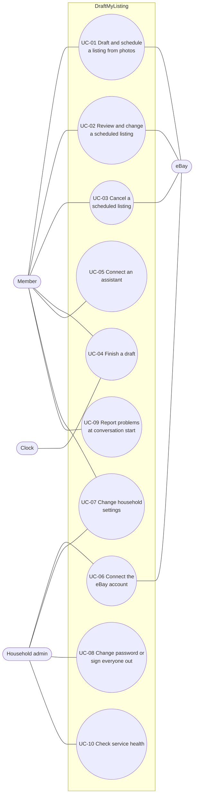

# DraftMyListing — Use Cases

> Version: 0.1 (draft) · Derived from [`docs/srs.md`](srs.md) · 2026-11-27
>
> Use-case-centric; no user stories. "Member" means anyone in the household
> using the shared sign-in. "The system" is DraftMyListing together with the
> assistant behavior its tools direct (SRS 1.3).

## Actors

| Actor | Kind | Description |
|---|---|---|
| Member | Primary, human | Anyone in the household, through Claude or ChatGPT on a phone or PC. |
| Household admin | Primary, human | Sobe, working on the NAS or in the assistant chat. |
| eBay | Secondary, system | eBay's APIs for the household seller account. |
| Clock | Secondary, time | Time-driven events: eBay starting a scheduled listing, the 30-day cleanup. |

## Diagram

## UC-01 Draft and schedule a listing from photos

- **Actors:** Member (primary); eBay.
- **Preconditions:** The member's assistant is signed in (UC-05). The eBay
  connection is valid (UC-06). Fewer than 20 listings have been created today.
- **Postconditions (success):** A complete auction is scheduled on eBay to
  start at least 24 hours later and end at 10 p.m. Eastern after 10 days, with
  the member's photos, Buy It Now 30% above the starting price, and the
  household's shipping and return settings. A draft remains until UC-04.
- **Main success scenario:**
  1. The member sends up to 12 photos of one item, with or without a note.
  2. The system identifies the item from the photos and note.
  3. The system chooses the eBay category and fills the required item
     specifics, and the recommended ones it knows.
  4. The system asks, in one message, for any required detail it cannot
     determine, and proposes a condition with the other allowed values.
  5. The member answers and confirms or picks the condition.
  6. The system finds at least 3 recent sold comparables and sets the starting
     price and Buy It Now price, showing the prices and their evidence.
  7. The system writes the title and description, estimates package size and
     weight, and orders and uploads the photos.
  8. The system validates the draft with eBay and reports the fees.
  9. The system creates the listing, scheduled for the earliest start at least
     24 hours away that ends the auction at 10 p.m. Eastern.
  10. The system tells the member the title, prices, start and end times and a
      link to the listing, and asks whether they are done with the draft
      (continues in UC-04).
- **Alternate flows:**
  - 2a. The item cannot be identified: the system asks for the brand or model,
    or a clearer label photo; resume at 2.
  - 2b. The photos show more than one item: the system asks whether to list
    them as one lot or list one item; resume at 2.
  - 1a. More than 12 photos: the system asks which to leave out.
  - 1b. A photo is too small, blurry or dark: the system asks for a retake.
  - 1c. A photo shows private information: the system points it out before
    uploading.
  - 1d. A photo is in a format eBay does not accept (such as HEIC): the system
    converts it.
  - 6a. Fewer than 3 sold comparables: the system uses current for-sale prices
    and says so.
  - 6b. No comparables at all: the system asks the member for a price.
  - 6c. The member names different prices: the system uses them, warning if
    Buy It Now would be less than 30% above the start.
  - 7a. The item is too large or heavy for the shipping service: the system
    asks how to handle it.
  - 8a. eBay rejects the draft: the system fixes what it can and validates
    again, or asks the member about the specific rejected detail.
  - 8b. eBay returns a warning: the system reports it and continues.
- **Exception flows:**
  - 2c. The item appears prohibited or restricted: the system says why and
    stops without listing.
  - 7b. A photo upload fails after retries: the system says which photo.
  - 8c. eBay is unavailable: the system keeps the draft and says it can be
    submitted later.
  - 9a. Creation fails part-way: a retry continues without duplicating.
  - 9b. The daily limit of 20 listings is reached: the system refuses and says
    so.
  - Any step: eBay connection expired or revoked: the system stops, keeps the
    draft, and says the eBay connection needs reconnecting.
- **Traces to:** FR-DRAFT-001..017, FR-PRICE-001..018, FR-PHOTO-001..010,
  FR-TERMS-002..010, FR-SCHED-001..011, FR-ASST-004..006, FR-ERR-001..005,
  FR-ERR-007, FR-EBAY-009.

## UC-02 Review and change a scheduled listing

- **Actors:** Member (primary); eBay.
- **Preconditions:** Signed in; eBay connection valid; the listing is
  scheduled, not live.
- **Postconditions (success):** The listing on eBay carries the change and
  keeps its listing ID and schedule.
- **Main success scenario:**
  1. The member asks for the household's scheduled listings.
  2. The system shows each with title, prices, and start and end times, read
     from eBay.
  3. The member picks one; the system shows its current details from eBay.
  4. The member asks for a change (title, description, prices, item
     specifics, condition, package size and weight, or photos).
  5. The system updates the listing on eBay and confirms the change.
- **Alternate flows:**
  - 4a. A price change would put Buy It Now less than 30% above the start:
    the system explains eBay's rule and proposes the lowest allowed value.
  - 4b. A photo change would exceed 12 photos: the system asks which to leave
    out.
- **Exception flows:**
  - 3a. The listing no longer exists on eBay: the system says it was removed.
  - 4c. The listing is live: the system says live listings can only be
    changed on eBay directly, and sends nothing to eBay.
  - 5a. eBay rejects the change: the system gives eBay's reason and suggests a
    fix.
- **Traces to:** FR-LIST-001..004, FR-LIST-009, FR-LIST-011..013,
  FR-PRICE-010, FR-PRICE-015, FR-PRICE-016, FR-PHOTO-013, FR-ERR-001,
  FR-ERR-002.

## UC-03 Cancel a scheduled listing

- **Actors:** Member (primary); eBay.
- **Preconditions:** Signed in; eBay connection valid; the listing is
  scheduled, not live.
- **Postconditions (success):** The listing is removed from eBay and never
  became visible to buyers.
- **Main success scenario:**
  1. The member asks to cancel a scheduled listing.
  2. The system asks the member to confirm.
  3. The member confirms.
  4. The system removes the listing from eBay without it going live.
  5. The system confirms from eBay that the listing is removed and never went
     live, and tells the member.
- **Alternate flows:**
  - 3a. The member does not confirm: nothing changes.
- **Exception flows:**
  - 1a. The listing is live: the system says it can only be changed on eBay
    directly, and sends nothing to eBay.
  - 4a. The cancel fails: the system tells the member at once, with the time
    left before the listing goes live, and directs them to delete it in Seller
    Hub. The failure is reported again at the next conversation (UC-09).
- **Traces to:** FR-LIST-006..008, FR-LIST-010, FR-LIST-012, FR-LIST-013,
  FR-NOTIF-002.

## UC-04 Finish a draft

- **Actors:** Member (primary); Clock.
- **Preconditions:** The draft's listing has been created on eBay (UC-01).
- **Postconditions (success):** DraftMyListing holds no information or files
  about the draft; eBay is the only record.
- **Main success scenario:**
  1. The system asks the member whether they are done with the draft.
  2. The member confirms.
  3. The system deletes the draft, its photos and every record about it.
- **Alternate flows:**
  - 2a. The member never confirms: 30 days after the listing was created, the
    Clock triggers the same deletion.
- **Traces to:** FR-PHOTO-011, FR-PHOTO-012, FR-PHOTO-014, FR-AUDIT-001,
  FR-AUDIT-002.

## UC-05 Connect an assistant

- **Actors:** Member (primary).
- **Preconditions:** The admin has set the household password and added the
  connector on the device.
- **Postconditions (success):** The assistant can use DraftMyListing and stays
  signed in while used at least once every 30 days.
- **Main success scenario:**
  1. The assistant connects for the first time; the system shows the
     household sign-in page.
  2. The member enters the household password.
  3. The system grants the assistant access and returns the member to the
     chat.
- **Alternate flows:**
  - 3a. Unused for more than 30 days: the next use requires signing in again.
- **Exception flows:**
  - 2a. Wrong password: the page asks again; after 5 wrong tries on one page
    the page stops and the member reconnects from the assistant.
  - 2b. 10 wrong passwords across all pages in 15 minutes: all sign-ins are
    refused for 15 minutes.
  - Any request without a valid sign-in is refused; an expired sign-in makes
    the assistant tell the member to reconnect.
- **Traces to:** FR-AUTH-001..010, FR-AUTH-012, FR-ASST-001..003.

## UC-06 Connect or reconnect the eBay account

- **Actors:** Household admin (primary); eBay.
- **Preconditions:** The admin has the household seller account's eBay
  sign-in.
- **Postconditions (success):** The system holds a valid connection to the
  household seller account, replacing any earlier one.
- **Main success scenario:**
  1. The admin runs the connect-eBay command on the NAS.
  2. The system gives an eBay sign-in link requesting only the needed scopes.
  3. The admin signs in to eBay and approves.
  4. eBay returns the admin to DraftMyListing; the system checks `state` and
     exchanges the code automatically.
  5. The system checks that the connected username is the household seller
     account and reports success.
- **Alternate flows:**
  - Ongoing: the system renews short-lived access automatically; within 30
    days of expiry it warns in every conversation (UC-09).
- **Exception flows:**
  - 4a. Code expired or `state` mismatch: the system explains, and the admin
    starts again.
  - 5a. Wrong eBay account: the system refuses the connection and says so.
- **Traces to:** FR-EBAY-001..008, FR-EBAY-010, FR-EBAY-011.

## UC-07 Change household settings

- **Actors:** Member or household admin (primary), in the assistant chat.
- **Preconditions:** Signed in.
- **Postconditions (success):** Later listings use the new setting.
- **Main success scenario:**
  1. The member asks to see the connected assistants, or to change a household
     setting (location, shipping, handling time, returns, international
     shipping).
  2. For a change, the system shows the current and new values and asks for
     confirmation.
  3. The member confirms; the system applies the change.
- **Exception flows:**
  - 2a. The new value is invalid: the system rejects it and says why.
  - 1a. The request is to change the password or sign everyone out: the
    system refuses; those are NAS-only (UC-08).
- **Traces to:** FR-ADMIN-003..006, FR-TERMS-001.

## UC-08 Change password or sign everyone out

- **Actors:** Household admin (primary), on the NAS.
- **Preconditions:** Admin access to the NAS.
- **Postconditions (success):** Every existing sign-in has ended; with a
  password change, only the new password works.
- **Main success scenario:**
  1. The admin runs the change-password command with a new password of at
     least 12 characters, or the sign-everyone-out command.
  2. The system stores the password only in hashed form (when changed) and
     ends every sign-in.
- **Exception flows:**
  - 1a. The password is shorter than 12 characters: the system refuses it.
- **Traces to:** FR-ADMIN-001, FR-ADMIN-002, FR-AUTH-007, FR-AUTH-008.

## UC-09 Report problems at conversation start

- **Actors:** Member (primary).
- **Preconditions:** Signed in.
- **Postconditions (success):** The member knows of every unresolved problem.
- **Main success scenario:**
  1. The member first uses DraftMyListing in a conversation.
  2. The system reports every unresolved problem it knows of: a failed cancel
     or change, or an eBay connection that has expired or expires within 30
     days (with the date).
- **Exception flows:**
  - None: with nothing to report, the system says nothing extra.
- **Traces to:** FR-NOTIF-001, FR-NOTIF-002, FR-EBAY-006, FR-EBAY-009.

## UC-10 Check service health

- **Actors:** Household admin (primary), on the NAS.
- **Preconditions:** Admin access to the NAS.
- **Postconditions (success):** The admin knows whether the service runs and
  whether the eBay connection is valid.
- **Main success scenario:**
  1. The admin runs the health check.
  2. The system reports whether the service is running and whether the eBay
     connection is valid.
- **Traces to:** NFR-OBS-001, NFR-OBS-002, FR-ERR-004.

## Cross-cutting requirements

These apply to every use case rather than to one flow: FR-ERR-006 (60
requests a minute per connection) and all non-functional requirements
(NFR-PERF-001..003, NFR-CAP-001, NFR-REL-001..003, NFR-SEC-001..003,
NFR-USE-001, NFR-COMP-001, NFR-MAINT-001..002, NFR-PORT-001,
NFR-COMPL-001..002, NFR-L10N-001..002, NFR-OBS-001..002).
