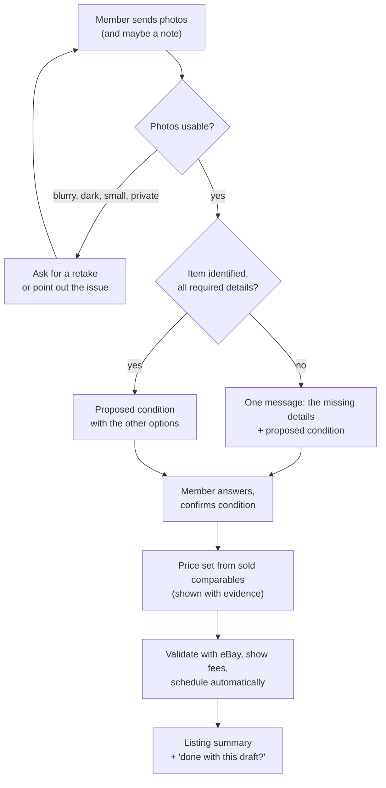
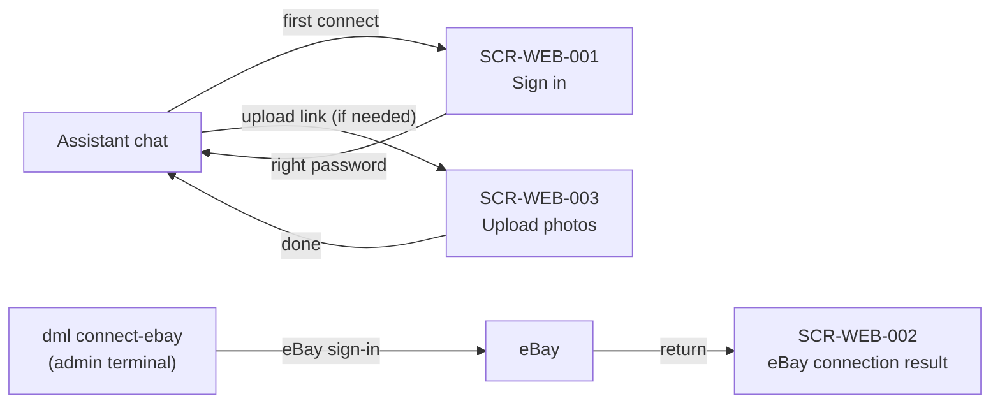

# UX Foundations: DraftMyListing

> Status: Approved by Sobe 2026-11-27 · Last updated: 2026-11-27
> Sources: [`docs/srs.md`](srs.md) · [`docs/architecture.md`](architecture.md) ·
> [`docs/use-cases.md`](use-cases.md)
> Design system: **[`docs/design.md`](design.md) + [`docs/tokens.json`](tokens.json)**
> (single source of truth for design values; this document references them)

## 1. Overview

DraftMyListing turns a few photos into a scheduled eBay auction, entirely from
a chat with Claude or ChatGPT. It has two surfaces:

- **Chat (`CHAT`):** the conversation in the member's assistant. This is where
  members spend nearly all their time; its "design" is what the assistant says
  and asks, steered by DraftMyListing's tool descriptions and results
  (architecture ADR-003).
- **Web pages (`WEB`):** two or three small pages opened from the chat or the
  admin's terminal: household sign-in, the eBay connection result, and a photo
  upload page if chat photos can't reach the server (ADR-008).

Design-source mode: research, reduced to a plain and clean proposal (Sobe,
2026-11-27).

## Part A — Shared core

### A1. Visual direction

Plain, calm and trustworthy: neutral greys, one blue accent, the device's
system font, large tap targets, automatic dark mode. See design.md §1.

### A2. Voice and tone

Plain, short and friendly, like a helpful family member who knows eBay. No
jargon, no codes, no exclamation marks. Every problem says what to do next.
Tone gets firmer, not louder, for anything irreversible or money-related
(cancel, fees, the daily limit). Microcopy rules: design.md §6.

### A3. Design language summary

A single-column card on a quiet background, one heading, one action. Tokens:
design.md §2 and tokens.json; components and states: design.md §4.

### A4. Accessibility standard

WCAG 2.2 AA, adopted by this design (the SRS sets no accessibility NFR).
NFR-USE-001 (a first-time member lists an item with no instructions) shapes
the chat patterns in Part B1. Rules: design.md §5.

### A5. Cross-surface principles

- **Ask only what the photos can't show** (FR-DRAFT-018), and ask it all at
  once (FR-DRAFT-005).
- **Confirm before anything irreversible:** cancel (FR-LIST-006) and household
  setting changes (FR-ADMIN-004).
- **Always end with the next step**, whether success, problem or limit
  (FR-ERR-002).
- **Same words everywhere:** "listing", "starting price", "Buy It Now",
  "goes live", "ends", "scheduled", "cancel", "household password".

## Part B — Surfaces

### B1. Chat — surface code `CHAT`

**Users and jobs** (SRS 2.3, household user and admin):
1. List an item from photos [UC-01].
2. Check, change or cancel scheduled listings [UC-02, UC-03].
3. Confirm a draft is done [UC-04].
4. Hear about problems [UC-09].
5. Change household settings [UC-07].

**Navigation model:** none. The member says what they want in their own words;
the assistant picks the tool. Tool descriptions must match everyday phrasing
(FR-ASST-006), for example "list this", "sell these shoes", "what's
scheduled?", "change the price to 40", "cancel the jacket".

**Key flow: list an item from photos [UC-01]**

**Screen inventory (chat moments).** In the chat surface a "screen" is a
message pattern the assistant produces from a tool result. Tool results carry
the facts; the assistant writes the words in this voice.

| ID | Moment | Purpose | Must contain | States |
|---|---|---|---|---|
| SCR-CHAT-001 | Clarifying questions | Get what the photos can't show | Every missing required detail in one numbered list; the proposed condition with the other allowed values | condition-only (nothing else missing) |
| SCR-CHAT-002 | Photo problem | Fix an unusable photo | Which photo, what's wrong, what to send instead | too small, blurry or dark, private info, over 12, upload failed |
| SCR-CHAT-003 | Price and evidence | Show the price being used | Starting price, Buy It Now, number of comparables, price range, up to 5 examples with price, date and source | sold-based, asking-price fallback (says so plainly), no comparables (asks for a price) |
| SCR-CHAT-004 | Listing scheduled | Confirm the result | Title, starting price, Buy It Now, fees (including $0), goes live and ends (member's time), eBay link, any eBay warning, then "Are you done with this draft?" | warning present |
| SCR-CHAT-005 | Scheduled listings | Overview | One line per listing: title, starting price, Buy It Now, goes live, ends | none scheduled |
| SCR-CHAT-006 | Listing detail | One listing, fresh from eBay | All current details | removed on eBay, already live (explain it can only be changed on eBay) |
| SCR-CHAT-007 | Change confirmed | Confirm an edit | What changed, old and new value | eBay rejected (reason and fix), Buy It Now under 30% (lowest allowed value) |
| SCR-CHAT-008 | Cancel confirmation | "Are you sure?" | Title, goes-live time, "this can't be undone" | — |
| SCR-CHAT-009 | Cancel result | Confirm the cancel | "Cancelled. It never went live." | failed (time left before it goes live, and how to delete it in Seller Hub) |
| SCR-CHAT-010 | Problems notice | Surface unresolved problems | Each problem in one line with what to do; eBay connection expiry date | expired connection |
| SCR-CHAT-011 | Limits and outages | Explain a refusal | What happened, when to try again | daily limit of 20, eBay busy or down, call limit |
| SCR-CHAT-012 | Household settings | View or change a setting | Current and new value, then a confirm question | invalid value |
| SCR-CHAT-013 | Reconnect | Sign-in expired | "Please reconnect DraftMyListing" and where | — |
| SCR-CHAT-014 | Can't list this | Prohibited or restricted item | Why, briefly; no listing created | — |

**Example: SCR-CHAT-004**

> Your listing is scheduled.
>
> **Nike Pegasus 40, men's size 11, blue: used, very good condition**
> Starting price $55.00 · Buy It Now $71.50
> eBay fees: $0.35, covered by a free listing credit ($0.00 to pay)
> Goes live Sat Nov 29, 7:00 p.m. · Ends Tue Dec 9, 7:00 p.m. (your time)
> [View on eBay](https://www.ebay.com/)
>
> You can still change anything before it goes live. Are you done with this
> draft?

**Surface-specific components:** none; the assistant renders text and links.
**Token overrides:** not applicable (no styling control in chat).

### B2. Web pages — surface code `WEB`

**Users and jobs:** a member signing in once per assistant [UC-05]; the admin
finishing the eBay connection [UC-06]; a member uploading photos if the chat
path fails [UC-01, ADR-008].

**Navigation:** none. Each page is reached from a link and returns the person
to where they came from.

| ID | Page | Purpose | Key states |
|---|---|---|---|
| SCR-WEB-001 | Sign in | Enter the household password to connect an assistant (FR-AUTH-001) | default; wrong password ("That password isn't right. Try again."); too many tries on this page ("Go back to your assistant and connect again."); temporarily blocked ("Too many wrong passwords. Try again in 15 minutes."); working |
| SCR-WEB-002 | eBay connection result | Tell the admin whether the eBay connection worked (FR-EBAY-002, 004, 010, 011) | connected (shows the eBay username); wrong eBay account; link expired or didn't match ("Run dml connect-ebay again."); eBay refused |
| SCR-WEB-003 | Upload photos | Provisional, only if spike R-2 needs it: pick up to 12 photos for one draft (EIR-UI-004) | default; chosen (count, "3 of 12"); over 12; uploading; done ("Photos received. Go back to your chat."); link used or expired |

Components: `card`, `input-text`, `button-primary`, `alert`, and
`file-picker` on SCR-WEB-003 (design.md §4). Token overrides: none.

## Part C — Cross-surface reconciliation

Two flows hop surfaces: sign-in (chat → SCR-WEB-001 → chat) and, if used, photo
upload (chat → SCR-WEB-003 → chat). In both, the page's last line tells the
member to go back to the chat, and the chat picks up without the member
repeating anything. Terms stay identical across surfaces (A5).

## Part D — Open questions and risks

- **SCR-WEB-003 may not exist:** decided by spike R-2 (architecture ADR-008).
- **Chat wording is not fully ours:** the assistant writes the final words.
  Tool descriptions and result fields steer it; real-phrasing tests in both
  assistants check it (R-9, FR-ASST-006).
- **Time zone:** the server knows Eastern time but not the member's own time
  zone; the assistant restates times in the member's zone (architecture §8.6).
  Check this in both assistants.
